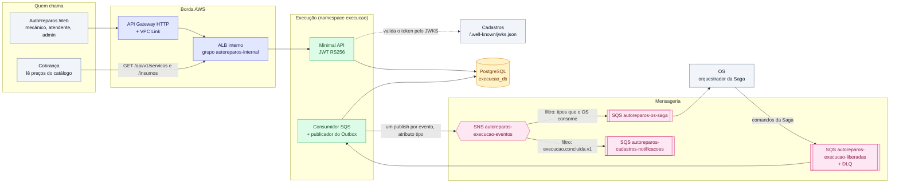
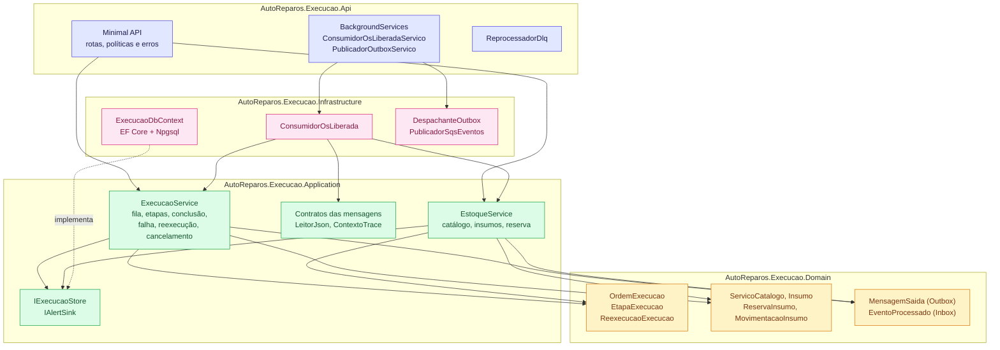
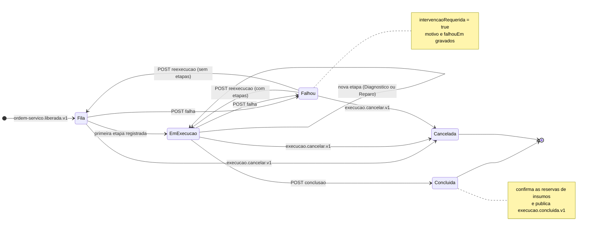
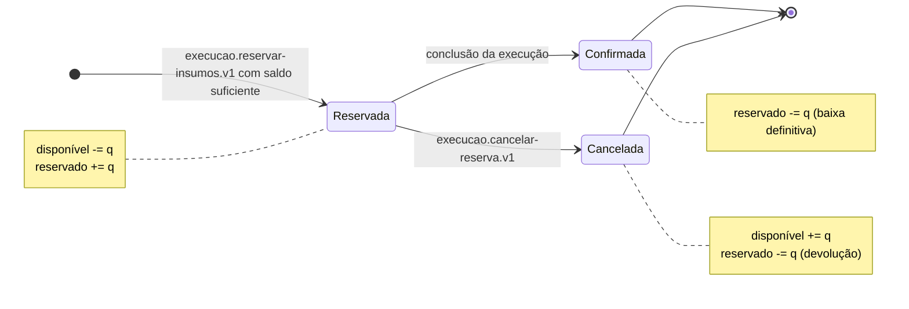
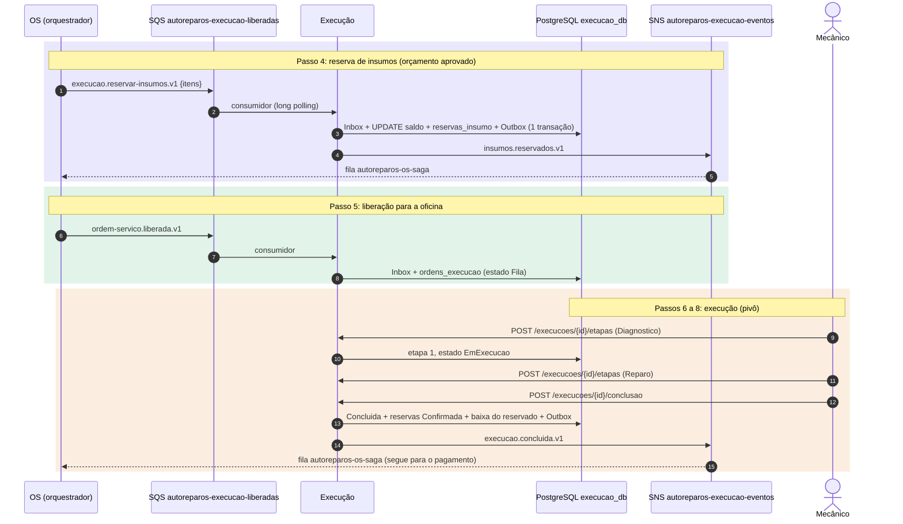
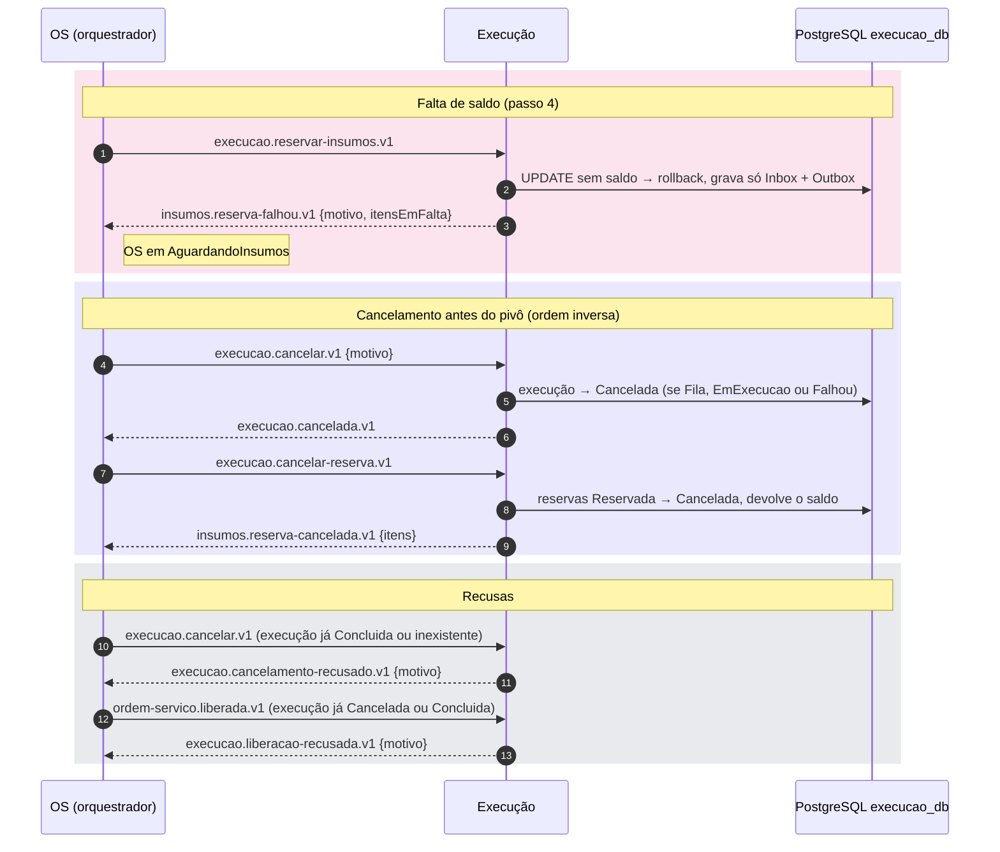
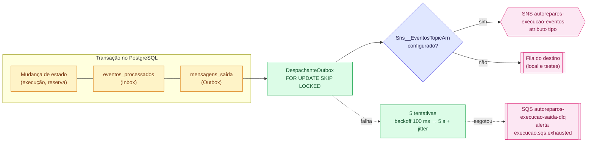
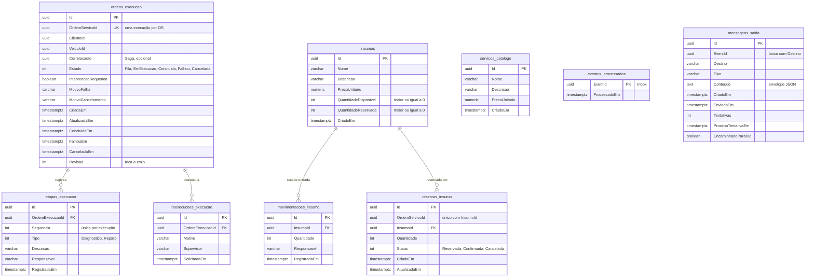
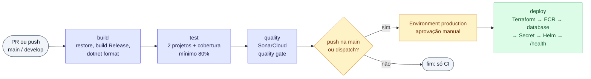

# AutoReparos.Execucao

> Microsserviço de **Execução e Produção** do AutoReparos, sistema de gestão de oficina mecânica do Tech Challenge FIAP SOAT (Fase 4: microsserviços, Saga Pattern e CI/CD).

[](https://github.com/Grupo78-PosTech-15SOAT/AutoReparos.Execucao/actions/workflows/ci-cd.yml)
[](https://sonarcloud.io/project/overview?id=Grupo78-PosTech-15SOAT_AutoReparos.Execucao)
[](https://sonarcloud.io/component_measures?id=Grupo78-PosTech-15SOAT_AutoReparos.Execucao&metric=coverage)

| | |
|---|---|
| **Stack** | .NET 10 (ASP.NET Core Minimal APIs), EF Core 10 + Npgsql, PostgreSQL 16, AWS SDK (SQS, SNS), OpenTelemetry |
| **Banco** | PostgreSQL próprio: database `execucao_db` e usuário `execucao_app` no RDS |
| **Mensageria** | Fila de entrada `autoreparos-execucao-liberadas` (SQS + DLQ) e tópico `autoreparos-execucao-eventos` (SNS) |
| **Produção** | EKS `AutoReparosEKS` (us-east-1), namespace `execucao`, atrás do API Gateway `https://8afyzjqfk2.execute-api.us-east-1.amazonaws.com` |
| **Papel na Saga** | Participante da Saga orquestrada pelo OS: reserva e devolve insumos, enfileira a OS liberada, conduz a execução e avisa a conclusão |

## Sumário

1. [Visão geral](#1-visão-geral)
2. [Arquitetura](#2-arquitetura)
3. [API REST](#3-api-rest)
4. [Regras de negócio e estados](#4-regras-de-negócio-e-estados)
5. [Papel na Saga](#5-papel-na-saga)
6. [Mensageria e confiabilidade](#6-mensageria-e-confiabilidade)
7. [Banco de dados](#7-banco-de-dados)
8. [Observabilidade](#8-observabilidade)
9. [Como rodar localmente](#9-como-rodar-localmente)
10. [Testes](#10-testes)
11. [Cobertura e qualidade](#11-cobertura-e-qualidade)
12. [CI/CD e deploy](#12-cicd-e-deploy)
13. [Configuração](#13-configuração)
14. [Repositórios do projeto](#14-repositórios-do-projeto)

---

## 1. Visão geral

O Execução é dono de tudo o que acontece **depois que a OS é liberada para a oficina**: a fila de execução, o registro das etapas de diagnóstico e reparo, a conclusão, a falha com intervenção e a reexecução. Também é dono do **catálogo de serviços e dos insumos (estoque)**, porque a reserva de insumos é passo e compensação da Saga e precisa da mesma transação da execução.

| Responsabilidade pedida no enunciado | Como o serviço atende |
|---|---|
| Gerenciar a fila de execução da OS | Consome `ordem-servico.liberada.v1` e cria uma única execução por OS; `GET /api/v1/fila-execucao` lista a fila com filtros |
| Atualizar status durante diagnóstico e reparos | `POST /api/v1/execucoes/{id}/etapas` registra etapas `Diagnostico` e `Reparo`; a primeira etapa leva a execução a `EmExecucao` |
| Comunicar finalização ao OS Service | `POST /api/v1/execucoes/{id}/conclusao` grava `execucao.concluida.v1` no Outbox, publicado no tópico SNS que a fila da Saga do OS assina |

O serviço não lê o banco de nenhum outro serviço: o OS fala com ele só por mensagens, e a Cobrança lê os preços do catálogo pela API REST.



---

## 2. Arquitetura

### 2.1 Camadas

O código segue Clean Architecture em quatro projetos. As dependências apontam para dentro: o domínio não conhece EF Core, AWS nem ASP.NET.

| Projeto | Responsabilidade | Principais tipos |
|---|---|---|
| [`AutoReparos.Execucao.Domain`](AutoReparos.Execucao.Domain) | Agregados e regras de transição, sem dependências externas | `OrdemExecucao`, `EtapaExecucao`, `ReexecucaoExecucao`, `ServicoCatalogo`, `Insumo`, `MovimentacaoInsumo`, `ReservaInsumo`, `MensagemSaida` (Outbox), `EventoProcessado` (Inbox) |
| [`AutoReparos.Execucao.Application`](AutoReparos.Execucao.Application) | Casos de uso, contratos das mensagens e portas | `ExecucaoService`, `EstoqueService`, `IExecucaoStore`, `TiposEvento`, `EventoOsLiberada`, `EventoCancelarExecucao`, `EventoReservarInsumos`, `EventoCancelarReserva`, `LeitorJson` (leitura estrita), `ContextoTrace` (W3C) |
| [`AutoReparos.Execucao.Infrastructure`](AutoReparos.Execucao.Infrastructure) | Persistência e integrações | `ExecucaoDbContext` (implementa `IExecucaoStore`), migrations, `ConsumidorOsLiberada`, `DespachanteOutbox`, `PublicadorSqsEventos`, `DependencyRetry`, `LoggingAlertSink` |
| [`AutoReparos.Execucao.Api`](AutoReparos.Execucao.Api) | Borda HTTP e processos de fundo | `Program.cs` (rotas, políticas, middleware de erros), `ServicosSegundoPlano`, `ReprocessadorDlq`, `MigracaoBancoDados`, `TelemetriaExecucao` |



### 2.2 Estrutura de pastas

```text
AutoReparos.Execucao/
├── AutoReparos.Execucao.Api/              # Program.cs, serviços de fundo, reprocessador de DLQ, telemetria
├── AutoReparos.Execucao.Application/      # ExecucaoService, EstoqueService, contratos e leitura estrita de JSON
├── AutoReparos.Execucao.Domain/           # Agregados, catálogo, insumos, reservas, Outbox e Inbox
├── AutoReparos.Execucao.Infrastructure/   # ExecucaoDbContext, Migrations/, consumidor SQS e publicador SQS/SNS
├── AutoReparos.Execucao.Tests/            # Testes de comportamento (PostgreSQL real via Testcontainers, SQS e SNS falsos)
├── AutoReparos.Execucao.IntegrationTests/ # Reserva de insumos e publicação da conclusão de ponta a ponta
├── deploy/helm/execucao/                  # Chart Helm: Deployment, Service, HPA, Ingress, Job de migração
├── infra/terraform/                       # ECR, filas SQS, tópico SNS, IRSA e segredo da database
├── postman/                               # Collection Postman das rotas
├── .github/workflows/ci-cd.yml            # build, test, quality e deploy
├── .github/scripts/verificar_cobertura.py # Une os relatórios Cobertura e exige 80% de linhas
├── Dockerfile                             # Build multi-stage (SDK 10 → ASP.NET 10), porta 8080
└── AutoReparos.Execucao.slnx
```

### 2.3 Decisões técnicas do serviço

| Decisão | Motivo |
|---|---|
| **Outbox transacional** (`mensagens_saida`) | Toda mensagem de saída é gravada na mesma transação da mudança de estado; um processo de fundo publica depois. Não há evento perdido nem evento de algo que não aconteceu |
| **Inbox por `eventId`** (`eventos_processados`) | A entrega do SQS é "pelo menos uma vez"; o `eventId` gravado na mesma transação garante efeito único, inclusive com entregas concorrentes |
| **Concorrência otimista por `xmin`** | `OrdemExecucao` e `ReservaInsumo` usam a coluna de sistema `xmin` como token. Toda mudança no agregado incrementa `Revisao`, então até a inserção de uma etapa filha altera a linha pai. Dois pedidos simultâneos resultam em um sucesso e um `409 conflito_concorrencia` |
| **Reserva atômica** | `UPDATE insumos ... WHERE "QuantidadeDisponivel" >= q` por item, em ordem estável de `InsumoId` (evita deadlock), com `CHECK` de saldo não negativo no banco; se algum item falta, nada é reservado |
| **Trava por OS** | `pg_advisory_xact_lock` por `ordemServicoId` serializa reserva e cancelamento de reserva da mesma OS |
| **Leitura estrita de JSON** | GUID só no formato canônico, chaves camelCase, texto sem NUL nem surrogate isolado, limites de tamanho; corpo inválido vira `422` (HTTP) ou DLQ (mensagem), sem persistir nada |
| **SQS e SNS com o AWS SDK** (sem MassTransit) | Controle explícito de retentativa, DLQ e atributos; menos uma dependência |

---

## 3. API REST

Todas as rotas exigem JWT RS256 emitido pelo **Cadastros** (validado por `Authority` e `Audience = autoreparos`), exceto `/health`. Sem token: `401`. Papel inadequado: `403`. As rotas que registram autoria (etapas, reexecução e entrada de estoque) também respondem `403` quando o token não traz a identidade do usuário (`sub` ou `nameidentifier`).

**Base em produção:** `https://8afyzjqfk2.execute-api.us-east-1.amazonaws.com`. O Ingress publica no API Gateway só os prefixos `/api/v1/execucoes`, `/api/v1/fila-execucao`, `/api/v1/servicos` e `/api/v1/insumos`; a rota administrativa de DLQ e o `/health` ficam acessíveis apenas dentro do cluster.

### 3.1 Endpoints

| Verbo | Rota | Autorização (política → papéis) | Corpo | Sucesso | Erros específicos |
|---|---|---|---|---|---|
| `GET` | `/api/v1/fila-execucao?status=&mecanico=` | `OperarExecucao` → `Mecanico`, `Administrador` | — | `200` `{ total, itens }` | `422 filtro_invalido` |
| `POST` | `/api/v1/execucoes/{id}/etapas` | `OperarExecucao` → `Mecanico`, `Administrador` | `{ "tipo": "Diagnostico" \| "Reparo", "descricao": "..." }` | `201` | `404`, `409`, `422 etapa_invalida` |
| `POST` | `/api/v1/execucoes/{id}/conclusao` | `OperarExecucao` → `Mecanico`, `Administrador` | — | `200` | `404`, `409` |
| `POST` | `/api/v1/execucoes/{id}/falha` | `OperarExecucao` → `Mecanico`, `Administrador` | `{ "motivo": "..." }` | `200` | `404`, `409`, `422 falha_invalida` |
| `POST` | `/api/v1/execucoes/{id}/reexecucao` | `ReexecutarExecucao` → `Administrador` | `{ "motivo": "..." }` | `202` | `404`, `409`, `422 reexecucao_invalida` |
| `GET` | `/api/v1/servicos?nome=` | qualquer usuário autenticado | — | `200` `{ itens }` | `422 filtro_invalido` |
| `POST` | `/api/v1/servicos` | `AdministrarCatalogo` → `Administrador` | `{ "nome", "descricao"?, "precoUnitario" }` | `201` | `422 servico_invalido` |
| `GET` | `/api/v1/insumos?nome=` | qualquer usuário autenticado | — | `200` `{ itens }` com saldos | `422 filtro_invalido` |
| `POST` | `/api/v1/insumos` | `AdministrarCatalogo` → `Administrador` | `{ "nome", "descricao"?, "precoUnitario", "quantidadeInicial"? }` | `201` | `422 insumo_invalido` |
| `POST` | `/api/v1/insumos/{id}/entradas` | `RegistrarEntradaInsumo` → `Administrador`, `Atendente` | `{ "quantidade": 1..1000000 }` | `200` | `404 insumo_nao_encontrado`, `422 entrada_invalida` |
| `POST` | `/api/v1/admin/dlq/reprocessar` | `AdministrarDlq` → `Administrador` | `{ "quantidade": 1..100 }` | `202` `{ solicitadas, reprocessadas }` | `422 quantidade_invalida` |
| `GET` | `/health` | anônima (probe do kubelet e health check do ALB) | — | `200` com a database acessível | `503` |

Detalhes das rotas:

- **Fila:** sem `status`, devolve as execuções que ainda pedem ação (`Fila`, `EmExecucao` e `Falhou`), em ordem de chegada. `status` aceita valores repetidos ou separados por vírgula (inclusive `Concluida` e `Cancelada`). `mecanico` filtra as execuções com etapa registrada por aquele responsável. Cada item traz as etapas em ordem de registro.
- **Etapas:** o responsável é a identidade do token. `tipo` aceita `Diagnostico`/`Diagnóstico` e `Reparo`, sem diferenciar maiúsculas.
- **Catálogo:** listagens ordenadas por nome, com até 500 itens; `nome` filtra por trecho, sem diferenciar maiúsculas. Preço positivo com até duas casas decimais; nome até 100 caracteres e descrição até 500.
- **Entrada de estoque:** soma ao saldo disponível e grava uma `MovimentacaoInsumo` (quantidade, responsável e horário) na mesma transação. O saldo disponível não passa de 1.000.000.000 (`422`).
- **Reprocessar DLQ:** devolve até `quantidade` mensagens das duas DLQs às filas de origem (seção 6.4) e registra o autor no alerta `execucao.dlq-reprocessada`.

### 3.2 Erros

Todo erro de regra traz um `codigo` estável no corpo JSON:

| Status | `codigo` | Quando |
|---|---|---|
| `404` | `execucao_nao_encontrada` / `insumo_nao_encontrado` | Recurso inexistente |
| `409` | `execucao_estado_invalido` | Transição não permitida pelo estado atual (inclui qualquer operação sobre execução `Cancelada`) |
| `409` | `conflito_concorrencia` | Outra operação alterou a execução primeiro; repita o pedido |
| `422` | `etapa_invalida`, `falha_invalida`, `reexecucao_invalida`, `filtro_invalido`, `servico_invalido`, `insumo_invalido`, `entrada_invalida`, `quantidade_invalida` | Corpo ou filtro inválido; nada é persistido |
| `503` | `dependencia_indisponivel` | Banco inalcançável ou falha transitória (com `Retry-After: 5`) |

São `422`: JSON quebrado, corpo que não é objeto, `Content-Type` diferente de JSON, tipos errados, `tipo` desconhecido, texto vazio, texto acima de 2000 caracteres, NUL (`\u0000`) e surrogate isolado. O corpo das requisições é limitado a 64 KiB.

### 3.3 Postman e OpenAPI

- **Postman:** [`postman/AutoReparos.Execucao.postman_collection.json`](postman/AutoReparos.Execucao.postman_collection.json), com as pastas *Execuções*, *Catálogo e estoque*, *Admin* e *Operação*. Variáveis: `baseUrl`, `token` (JWT obtido no `POST /api/auth/login` do Cadastros) e `id`.
- **OpenAPI:** em ambiente `Development` o documento fica em `/openapi/v1.json`.

---

## 4. Regras de negócio e estados

### 4.1 Execução

Uma OS entra na fila **uma única vez** (`OrdemServicoId` é único em `ordens_execucao`). A falha exige intervenção, e só o administrador (supervisor) pode reexecutar; a reexecução preserva todas as etapas e registra motivo, supervisor e horário. `Cancelada` só é alcançada pelo comando da Saga, não há rota HTTP de cancelamento.



| Operação | Estados aceitos | Efeito |
|---|---|---|
| Registrar etapa | `Fila`, `EmExecucao` | Etapa com sequência crescente, tipo, descrição, responsável e horário; estado vai a `EmExecucao` |
| Concluir | `EmExecucao` | `Concluida`, confirma as reservas e grava `execucao.concluida.v1` no Outbox, tudo na mesma transação |
| Falhar | `Fila`, `EmExecucao` | `Falhou` com `intervencaoRequerida = true`; grava `execucao.falhou.v1` no Outbox |
| Reexecutar | `Falhou` | Volta a `EmExecucao` (ou `Fila`, se não havia etapas); intervenção deixa de ser necessária |
| Cancelar (Saga) | `Fila`, `EmExecucao`, `Falhou` | `Cancelada` com `motivoCancelamento` e `canceladaEm`; etapas preservadas |

### 4.2 Reserva de insumos em duas fases

O saldo de cada insumo tem duas partes: `QuantidadeDisponivel` (livre) e `QuantidadeReservada` (presa a uma OS em andamento). A reserva é única por par (OS, insumo).



- **Tudo ou nada:** se algum item não tem saldo, nenhum item é reservado e a Saga recebe `insumos.reserva-falhou.v1` com `itensEmFalta` (`insumoId`, `quantidadeSolicitada`, `quantidadeDisponivel`).
- **Itens repetidos** do mesmo insumo são somados numa linha; o comando aceita até 200 itens.
- **Comando repetido** (mesmo ou outro `eventId`) para uma OS que já tem reserva não reserva de novo: a Saga recebe o mesmo desfecho.
- **Cancelamento** devolve só as reservas `Reservada`; as `Confirmada` permanecem. Sem reserva alguma, só confirma à Saga.

### 4.3 Catálogo inicial

A migration `202611150001_CatalogoInsumosReservas` semeia cinco serviços (troca de óleo e filtro, alinhamento e balanceamento, revisão de freios, diagnóstico eletrônico e troca de bateria) e cinco insumos com saldo inicial (óleo 5W30, filtro de óleo, pastilha de freio, fluido de freio e bateria 60Ah).

---

## 5. Papel na Saga

### 5.1 Estratégia: Saga orquestrada pelo OS

O AutoReparos usa **Saga orquestrada**, com o serviço de OS como orquestrador e o estado da Saga persistido em DynamoDB (decisão D-07 do projeto). A OS tem passos sequenciais com compensação em ordem inversa (reservar insumos, aprovar o orçamento, executar, cobrar), e um ponto único que conhece o estado facilita travas, prazos, auditoria e intervenção manual; na coreografia esse conhecimento ficaria espalhado pelos eventos dos três serviços.

O Execução é **participante**: não conhece o fluxo inteiro, não decide o próximo passo e fala com o orquestrador só por mensagens. Ele recebe **comandos** na própria fila e responde com **eventos** pelo Outbox.

| # | Passo da Saga | Tipo do passo | Comando recebido | Resposta publicada | Compensação |
|---|---|---|---|---|---|
| 4 | Reservar insumos | Compensável | `execucao.reservar-insumos.v1` | `insumos.reservados.v1` ou `insumos.reserva-falhou.v1` | `execucao.cancelar-reserva.v1` → `insumos.reserva-cancelada.v1` |
| 5 | Liberar para execução | Compensável | `ordem-servico.liberada.v1` | `execucao.liberacao-recusada.v1` se a execução da OS já terminou | `execucao.cancelar.v1` → `execucao.cancelada.v1` ou `execucao.cancelamento-recusado.v1` |
| 6 | Início da execução | **Pivô** | primeira etapa pela API | — | a partir daqui não há compensação automática, só intervenção |
| 7 | Execução e conclusão | Retentável | etapas, conclusão ou falha pela API | `execucao.concluida.v1` ou `execucao.falhou.v1` | falha: reexecução pelo administrador ou cancelamento pela Saga |
| 8 | Confirmar insumos | Retentável | — | (mesma transação da conclusão) | — |

Na falta de saldo (passo 4), nada é gravado e o OS deixa a OS em `AguardandoInsumos` até a reposição e nova tentativa, ou o cancelamento.

### 5.2 Fluxo feliz



### 5.3 Compensações



| Comando | Estado atual | Resultado | Resposta |
|---|---|---|---|
| `execucao.cancelar.v1` | `Fila`, `EmExecucao` ou `Falhou` | vai a `Cancelada`, etapas preservadas | `execucao.cancelada.v1` |
| `execucao.cancelar.v1` | `Cancelada` (outro `eventId`) | nada muda; o primeiro motivo fica | `execucao.cancelada.v1` |
| `execucao.cancelar.v1` | `Concluida` ou inexistente | recusado | `execucao.cancelamento-recusado.v1` |
| `ordem-servico.liberada.v1` | já `Cancelada` ou `Concluida` | não volta à fila | `execucao.liberacao-recusada.v1` |
| `execucao.cancelar-reserva.v1` | reservas `Reservada` | `Cancelada` e saldo devolvido | `insumos.reserva-cancelada.v1` |

Cada comando é idempotente pelo `eventId`: entrega repetida ou concorrente cancela, reserva ou responde uma vez só. Se outra operação altera a execução durante o comando (conflito de `xmin`), o serviço refaz a leitura até 3 vezes em vez de perder o comando.

### 5.4 Contratos

Todas as mensagens usam JSON camelCase com o envelope comum `eventId`, `tipo`, `correlacaoId` (identificador da Saga, opcional) e `ocorreuEm`, mais `traceparent`/`tracestate` quando há trace ativo (seção 8). GUIDs só no formato canônico `8-4-4-4-12`. `correlacaoId` vem do comando (ou da execução, quando o comando não traz) e é `null` se ausente.

<details>
<summary><b>Comandos consumidos</b> (fila <code>autoreparos-execucao-liberadas</code>)</summary>

```json
{
  "eventId": "6f1c2a3e-0b7d-4c55-9a1e-2d8f4b6c7a90",
  "tipo": "ordem-servico.liberada.v1",
  "correlacaoId": "c0a8012e-7d4b-4e21-9f33-0a1b2c3d4e5f",
  "id": "b3d5f7a1-1c2e-4f60-8a9b-0c1d2e3f4a5b",
  "clienteId": "0a1b2c3d-4e5f-4a6b-8c7d-9e0f1a2b3c4d",
  "veiculoId": "5e6f7a8b-9c0d-4e1f-a2b3-c4d5e6f7a8b9"
}
```

`id` é o identificador da OS. Os demais comandos usam `ordemServicoId`:

```json
{ "eventId": "...", "tipo": "execucao.reservar-insumos.v1", "correlacaoId": "...", "ordemServicoId": "...",
  "itens": [ { "insumoId": "1a5f0001-0000-4000-8000-000000000001", "quantidade": 4 } ] }

{ "eventId": "...", "tipo": "execucao.cancelar-reserva.v1", "correlacaoId": "...", "ordemServicoId": "..." }

{ "eventId": "...", "tipo": "execucao.cancelar.v1", "correlacaoId": "...", "ordemServicoId": "...",
  "ocorreuEm": "2026-11-10T12:00:00Z", "motivo": "Orçamento cancelado pelo cliente" }
```

</details>

<details>
<summary><b>Eventos publicados</b> (tópico <code>autoreparos-execucao-eventos</code>)</summary>

| `tipo` | Campos além do envelope | Assinantes em produção |
|---|---|---|
| `execucao.concluida.v1` | `id` (execução), `ordemServicoId`, `clienteId`, `veiculoId`, `concluidaEm` | fila da Saga do OS e fila de notificações do Cadastros (e-mail ao cliente) |
| `execucao.falhou.v1` | `id`, `ordemServicoId`, `clienteId`, `veiculoId`, `motivo`, `falhouEm` | fila da Saga do OS |
| `execucao.cancelada.v1` | `ordemServicoId`, `execucaoId` | fila da Saga do OS |
| `execucao.cancelamento-recusado.v1` | `ordemServicoId`, `execucaoId` (se existir), `motivo` | fila da Saga do OS |
| `execucao.liberacao-recusada.v1` | `ordemServicoId`, `motivo` | fila da Saga do OS |
| `insumos.reservados.v1` | `ordemServicoId`, `itens` | fila da Saga do OS |
| `insumos.reserva-falhou.v1` | `ordemServicoId`, `motivo`, `itensEmFalta` | fila da Saga do OS |
| `insumos.reserva-cancelada.v1` | `ordemServicoId`, `itens` | fila da Saga do OS |

```json
{
  "eventId": "9d2a1c44-5b3e-4f10-8e7a-1b2c3d4e5f60",
  "tipo": "execucao.concluida.v1",
  "correlacaoId": "c0a8012e-7d4b-4e21-9f33-0a1b2c3d4e5f",
  "ocorreuEm": "2026-11-13T18:45:00+00:00",
  "id": "<id da execução>",
  "ordemServicoId": "<id da OS>",
  "clienteId": "<id do cliente>",
  "veiculoId": "<id do veículo>",
  "concluidaEm": "2026-11-13T18:45:00+00:00"
}
```

</details>

---

## 6. Mensageria e confiabilidade

### 6.1 Entrada: fila própria com DLQ

Um único consumidor (`ConsumidorOsLiberada`) lê `autoreparos-execucao-liberadas` em lotes de até 10 mensagens com long polling de 20 s e despacha pelo campo `tipo`. Cada mensagem é aplicada numa transação que grava negócio, Inbox e Outbox juntos.

- **Mensagem malformada** (JSON inválido, `tipo` desconhecido, campo ausente ou inválido, GUID não canônico): vai à DLQ de entrada com o alerta `execucao.evento_invalido` e sai da fila; nada é persistido nem respondido.
- **Falha transitória do banco** (rede, timeout): repete até 5 vezes; ao esgotar, vai à DLQ de entrada com o alerta `execucao.banco.exhausted`. Se o envio à DLQ falhar, a mensagem não é removida e volta após o timeout de visibilidade (alerta `execucao.entrada.dlq_failed`).
- **Redrive do SQS:** a fila tem `maxReceiveCount = 5` para a DLQ `autoreparos-execucao-liberadas-dlq`.

### 6.2 Saída: Outbox publicado no SNS

O `PublicadorOutboxServico` pega a próxima linha pendente de `mensagens_saida` com `FOR UPDATE SKIP LOCKED` (várias réplicas não publicam a mesma linha) e a entrega ao `PublicadorSqsEventos`:

- **Com `Sns__EventosTopicArn`** (produção, D-67): cada linha é publicada **uma vez** no tópico `autoreparos-execucao-eventos` com o atributo de mensagem `tipo`. Cada consumidor assina a própria fila com raw message delivery e filtro por `tipo`, e deduplica pelo `eventId`.
- **Sem o tópico** (testes e execução local): cada linha vai à fila do seu destino; `os-service` e `topico` vão a `Sqs__OsServiceQueueUrl`, e `billing` (linhas antigas) a `Sqs__BillingQueueUrl`.



### 6.3 Retentativas

| Dependência | Política | Ao esgotar |
|---|---|---|
| SNS/SQS (publicação) | 5 tentativas, backoff exponencial 100, 200, 400, 800 ms (teto 5 s) + jitter de 0 a 99 ms | Corpo enviado à `autoreparos-execucao-saida-dlq`, linha marcada como enviada à DLQ, alerta `execucao.sqs.exhausted`. Se a DLQ também falhar: alerta `execucao.sqs.dlq_failed` e a linha fica pendente com nova tentativa agendada |
| Banco (consumidor) | 5 tentativas só para falhas transitórias | DLQ de entrada, alerta `execucao.banco.exhausted` |
| Banco (API) | — | `503 dependencia_indisponivel` com `Retry-After: 5` |
| Conflito de concorrência em comando da Saga | até 3 releituras | — |

### 6.4 Reprocessamento das DLQs

`POST /api/v1/admin/dlq/reprocessar` (só `Administrador`, só dentro do cluster) lê primeiro a DLQ de entrada e devolve as mensagens a `autoreparos-execucao-liberadas`; depois lê a DLQ de saída e devolve cada evento à fila do destino pelo `tipo` (`execucao.concluida.v1` ao OS e à Cobrança; os demais só ao OS). A mensagem só sai da DLQ depois de reenviada, e a deduplicação por `eventId` dos consumidores torna o reenvio seguro.

---

## 7. Banco de dados

PostgreSQL 16 exclusivo do serviço: em produção, a database `execucao_db` com o usuário `execucao_app` na instância RDS compartilhada, criados pelo provisionador da plataforma (`autoreparos-provisionador-db`) no deploy. Nenhum outro serviço acessa estas tabelas. As migrations são escritas à mão em [`AutoReparos.Execucao.Infrastructure/Migrations`](AutoReparos.Execucao.Infrastructure/Migrations).

| Migration | Conteúdo |
|---|---|
| `202611130001_InitialExecucao` | Execuções, etapas, reexecuções, Inbox e Outbox |
| `202611140001_SagaCancelamentoCorrelacao` | `CorrelacaoId`, `MotivoCancelamento` e `CanceladaEm` na execução |
| `202611150001_CatalogoInsumosReservas` | Catálogo, insumos (com `CHECK` de saldo não negativo), movimentações, reservas e seed do catálogo |



`reservas_insumo.OrdemServicoId` e `ordens_execucao.OrdemServicoId` guardam o identificador da OS, que pertence ao serviço de OS; não há chave estrangeira entre eles.

**Migrations em produção (ADR-004):** o Job Helm `execucao-migracao` roda como hook `pre-install,pre-upgrade` com `Database__RunMigrations=true`: aplica as migrations pendentes e sai sem abrir HTTP (código 1 se falhar, e o `--atomic` do Helm desfaz a release). Os pods sobem com `Database__SkipStartupMigration=true`. Fora do cluster, o serviço migra na inicialização.

---

## 8. Observabilidade

O serviço exporta traces, métricas e logs por OTLP para o OpenTelemetry Collector da stack de observabilidade da Fase 3 (`autoreparos-otel-collector.autoreparos.svc.cluster.local:4317` no cluster), que alimenta Jaeger, Prometheus, Loki e Grafana.

| Sinal | O que é coletado |
|---|---|
| **Traces** | ASP.NET Core e HttpClient, mais a fonte `AutoReparos.Execucao.Mensageria`: span `Consumer` `processar <tipo>` a cada mensagem consumida e span `Producer` `publicar <tipo>` a cada publicação, com os atributos `messaging.system` (`aws_sqs` ou `aws_sns`), `messaging.message.id` (`eventId`) e `ordem_servico.id` |
| **Propagação W3C** (D-65) | `traceparent` e `tracestate` entram no JSON do envelope quando a mensagem é criada, na mesma transação do Outbox; o consumidor continua o trace do produtor. Mensagem sem contexto válido vira um trace novo e segue o processamento |
| **Métricas** | ASP.NET Core, HttpClient e runtime do .NET |
| **Logs** | Logs estruturados com mensagem formatada e escopos |
| **Recurso** | `service.name` = `autoreparos-execucao` no cluster (padrão do código: `autoreparos-execution`) e `deployment.environment.name` |
| **Alertas** | Logs `Critical` com prefixo `ALERTA` e código estável: `execucao.evento_invalido`, `execucao.banco.exhausted`, `execucao.entrada.dlq_failed`, `execucao.sqs.exhausted`, `execucao.sqs.dlq_failed`, `execucao.dlq-reprocessada` |
| **Saúde** | `GET /health` verifica a conexão com a database (EF Core health check); usado nas probes de readiness e liveness e no health check do ALB |

Com isso, um trace no Jaeger atravessa OS → fila → Execução → tópico → OS para a mesma `ordem_servico.id`.

---

## 9. Como rodar localmente

**Pré-requisitos:** .NET SDK 10, Docker (para o PostgreSQL e para os testes) e, para obter tokens, o [Cadastros](https://github.com/Grupo78-PosTech-15SOAT/AutoReparos.Cadastros) rodando localmente (emissor do JWT).

```sh
# 1. PostgreSQL local
docker run -d --name execucao-postgres -p 5433:5432 \
  -e POSTGRES_DB=execucao_db -e POSTGRES_USER=execucao_app -e POSTGRES_PASSWORD='<senha-local>' \
  postgres:16-alpine

# 2. Configuração mínima (sem AWS: consumidor e publicador desligados)
export ConnectionStrings__Execucao="Host=localhost;Port=5433;Database=execucao_db;Username=execucao_app;Password=<senha-local>"
export Authentication__Authority=http://localhost:8080      # Cadastros local
export Authentication__Audience=autoreparos
export Authentication__RequireHttpsMetadata=false
export BackgroundServices__Enabled=false
export AWS_REGION=us-east-1

# 3. API em http://localhost:5145 (aplica as migrations na subida)
dotnet run --project AutoReparos.Execucao.Api
```

Obtenha um token com `POST http://localhost:8080/api/auth/login` no Cadastros e use a collection Postman com `baseUrl = http://localhost:5145`.

**Imagem Docker:**

```sh
docker build -t autoreparos-execucao .
docker run --rm -p 8080:8080 -e ConnectionStrings__Execucao=... -e Authentication__Authority=... autoreparos-execucao
```

---

## 10. Testes

As provas usam **PostgreSQL real** (`postgres:16-alpine` via Testcontainers) e `IAmazonSQS`/`IAmazonSimpleNotificationService` falsos: não precisam de AWS nem de variáveis de ambiente, só do Docker. Stack: xUnit, `Microsoft.AspNetCore.Mvc.Testing` (a API sobe inteira em memória), Testcontainers e coverlet.

```sh
dotnet restore AutoReparos.Execucao.slnx
dotnet build AutoReparos.Execucao.slnx -m:1
dotnet test AutoReparos.Execucao.Tests
dotnet test AutoReparos.Execucao.IntegrationTests
dotnet format AutoReparos.Execucao.slnx --verify-no-changes --no-restore
```

Execução local em 17/11/2026: **171 testes, todos aprovados** (161 em `AutoReparos.Execucao.Tests` e 10 em `AutoReparos.Execucao.IntegrationTests`).

| Classe | O que prova |
|---|---|
| `FilaExecucaoTests` (`ReleasedOrderQueuedOnce`) | OS liberada entra na fila uma vez; filtros de estado e mecânico; papéis |
| `EtapasExecucaoTests` (`ExecutionStageHistory`) | Histórico de etapas com sequência, responsável e horário; validações e `409` por estado |
| `ConclusaoExecucaoTests` (`ExecutionCompletion`) | Conclusão grava uma linha de Outbox por evento; pedidos concorrentes publicam uma vez |
| `ReexecucaoTests` (`ManualReexecutionPreservesStages`) | Reexecução só do administrador, só após falha, preservando as etapas |
| `DeduplicacaoTests` (`DuplicateEventDeduplication`) | Evento repetido ou concorrente não duplica a execução; malformado vai à DLQ |
| `ResilienciaTests` (`DependencyRetryExhaustion`) | Backoff com jitter, 5 tentativas, DLQ e alertas para SQS e banco; `503` com `Retry-After` |
| `CancelamentoExecucaoTests` (`ExecutionCancellation`, `ReleaseRefusal`, `SagaCorrelation`) | Compensação da Saga, liberação recusada e propagação do `correlacaoId` |
| `CatalogoInsumosTests` | Catálogo com preço e saldos, seed da migration, entradas (inclusive concorrentes) |
| `PublicacaoSnsTests` | Publicação única no tópico com o atributo `tipo`, linhas antigas, retentativa e DLQ |
| `TraceMensageriaTests` | Spans `Producer` e `Consumer` com o pai extraído do envelope |
| `ReprocessaDlqTests` | Reprocessamento das duas DLQs até a quantidade pedida; papel e quantidade inválidos |
| `DominioTests` | Invariantes dos agregados e da reserva |
| `SaudeEndpointTests`, `MigracaoNaInicializacaoTests`, `MigrarESairTests`, `TelemetriaTests`, `CredenciaisIrsaTests` | `/health` anônimo, modos de migração do Job Helm, recurso OTel e cliente STS do IRSA |
| `ReservaInsumosTests` (integração) | Reserva tudo ou nada, sem duplicar, concorrência respeitando saldo, confirmação na conclusão, devolução no cancelamento, comando inválido na DLQ |
| `ConclusaoPublicadaTests` (integração) | Conclusão chega à fila do OS com os serviços de fundo ligados |

O BDD do fluxo completo da OS e das compensações, exigido pelo enunciado, fica no repositório do orquestrador ([`AutoReparos.OS`](https://github.com/Grupo78-PosTech-15SOAT/AutoReparos.OS), projeto `AutoReparos.OS.BddTests`, D-63).

---

## 11. Cobertura e qualidade

| Item | Valor |
|---|---|
| **Limite mínimo** | **80%** de cobertura de linhas, verificado no CI (job `test`) |
| **Medição local (17/11/2026)** | **97,56%** de linhas (1000 de 1025), os dois projetos de teste somados |
| **Relatório no SonarCloud** | https://sonarcloud.io/project/overview?id=Grupo78-PosTech-15SOAT_AutoReparos.Execucao |
| **Quality gate** | SonarCloud, projeto `Grupo78-PosTech-15SOAT_AutoReparos.Execucao`, organização `grupo78-postech-15soat` |

Como a cobertura é medida:

1. O job `test` roda os dois projetos de teste com `XPlat Code Coverage` nos formatos Cobertura e OpenCover, excluindo `**/Migrations/*.cs` e `**/obj/**`.
2. [`.github/scripts/verificar_cobertura.py`](.github/scripts/verificar_cobertura.py) une os relatórios `coverage.cobertura.xml` (uma linha conta como coberta se algum relatório a cobriu) e **falha o pipeline** se o total ficar abaixo de `MINIMO_COBERTURA` (80).
3. O job `quality` envia os relatórios OpenCover e os `.trx` ao SonarCloud e espera o quality gate (`sonar.qualitygate.wait=true`); `bin`, `obj` e `Migrations` ficam fora da análise.

Para reproduzir a medição localmente:

```sh
dotnet test AutoReparos.Execucao.Tests --results-directory TestResults/AutoReparos.Execucao.Tests --collect:"XPlat Code Coverage" \
  -- DataCollectionRunSettings.DataCollectors.DataCollector.Configuration.Format=cobertura,opencover
dotnet test AutoReparos.Execucao.IntegrationTests --results-directory TestResults/AutoReparos.Execucao.IntegrationTests --collect:"XPlat Code Coverage" \
  -- DataCollectionRunSettings.DataCollectors.DataCollector.Configuration.Format=cobertura,opencover
python3 .github/scripts/verificar_cobertura.py TestResults --minimo 80
```

---

## 12. CI/CD e deploy

### 12.1 Pipeline

O workflow [`.github/workflows/ci-cd.yml`](.github/workflows/ci-cd.yml) roda em pull request e push para `main` e `develop` e por `workflow_dispatch`. O deploy é independente dos demais serviços: só este repositório implanta o Execução.



| Job | Quando roda | O que faz |
|---|---|---|
| `build` | sempre | `dotnet restore`, `dotnet build -c Release` e `dotnet format --verify-no-changes` |
| `test` | depois do `build` | Testes dos dois projetos com cobertura; falha abaixo de 80%; publica `TestResults` como artefato |
| `quality` | push na `main` ou PR para a `main` | SonarCloud com quality gate obrigatório; falha de propósito sem `SONAR_TOKEN` |
| `deploy` | push ou `workflow_dispatch` na `main`, depois dos três jobs | Implanta em produção no Environment `production`, que exige aprovação |

As mudanças chegam à `main` por pull request a partir da `develop`. A proteção da `main` com `build`, `test` e `quality` como status checks obrigatórios está decidida para o projeto (D-25), mas ainda não está aplicada neste repositório.

### 12.2 Passos do deploy

1. Assume a role de deploy por OIDC do GitHub (`vars.AWS_ROLE_ARN`), sem chave de acesso estática.
2. `terraform apply` em [`infra/terraform`](infra/terraform) (state no S3 com lock no DynamoDB).
3. `docker build` e `push` da imagem no ECR `autoreparos-execucao`, com a tag igual ao SHA do commit.
4. Lê os parâmetros da plataforma no SSM (`/autoreparos/production/eks/cluster_name`, `/provisionador-db/url`, `/apigateway/endpoint`).
5. Chama o provisionador `autoreparos-provisionador-db` (Function URL com SigV4), que cria de forma idempotente a database `execucao_db` e o usuário `execucao_app`.
6. Cria o Secret `execucao-database` no namespace `execucao` com a connection string lida do Secrets Manager (mascarada no log).
7. `helm upgrade --install execucao deploy/helm/execucao --atomic --wait`: o hook roda o Job de migração antes do rollout.
8. Confere `kubectl rollout status` e um `GET /health` com `200` pelo Service.

### 12.3 Infraestrutura do serviço

| Recurso | Onde | Detalhe |
|---|---|---|
| ECR `autoreparos-execucao` | [`infra/terraform/ecr.tf`](infra/terraform/ecr.tf) | Scan na publicação; mantém as 10 imagens mais recentes |
| SQS `autoreparos-execucao-liberadas` + `-dlq` | [`infra/terraform/sqs.tf`](infra/terraform/sqs.tf) | Visibilidade 90 s, long polling 20 s, redrive após 5 recebimentos, SSE gerenciado |
| SQS `autoreparos-execucao-saida-dlq` | [`infra/terraform/sqs.tf`](infra/terraform/sqs.tf) | Eventos do Outbox que esgotaram as tentativas (retenção de 14 dias) |
| SNS `autoreparos-execucao-eventos` | [`infra/terraform/sns.tf`](infra/terraform/sns.tf) | Criptografado com `alias/aws/sns`; os consumidores criam a própria assinatura |
| IAM `autoreparos-execucao-irsa` | [`infra/terraform/iam.tf`](infra/terraform/iam.tf) | IRSA do ServiceAccount `execucao/execucao`, com permissions boundary; consome as próprias filas, envia às filas da Saga e da Cobrança e publica no tópico |
| Secrets Manager `autoreparos/production/execucao/database` | [`infra/terraform/segredo.tf`](infra/terraform/segredo.tf) | Senha gerada pelo Terraform e connection string |
| Testes do Terraform | [`infra/terraform/tests`](infra/terraform/tests) | `terraform test` com provider simulado: nomes, redrive, IRSA, segredo e tópico |

O chart [`deploy/helm/execucao`](deploy/helm/execucao) contém:

| Objeto | Detalhe |
|---|---|
| `Deployment` | 1 réplica, porta 8080, usuário não root, readiness e liveness em `/health`, requests de 50m CPU / 160Mi e limites de 500m / 384Mi |
| `HorizontalPodAutoscaler` | 1 a 3 réplicas por CPU (80%) |
| `Service` e `ServiceAccount` | ServiceAccount anotado com a role IRSA |
| `Ingress` | ALB interno do grupo `autoreparos-internal` (ordem 30), alcançado pelo VPC Link do API Gateway |
| `Job` `execucao-migracao` | Hook `pre-install,pre-upgrade` que migra e sai |

---

## 13. Configuração

Toda a configuração chega por variáveis de ambiente. Nunca versione tokens ou connection strings. Em produção, a connection string vem do Secret `execucao-database` e as demais variáveis são montadas pelo chart a partir de [`values.yaml`](deploy/helm/execucao/values.yaml).

| Variável | Finalidade | Produção |
|---|---|---|
| `ConnectionStrings__Execucao` | Conexão com o PostgreSQL do serviço (**segredo**) | Secret `execucao-database` |
| `Authentication__Authority` | Emissor do JWT; o JWKS é descoberto em `/.well-known/openid-configuration` | URL do API Gateway |
| `Authentication__Audience` | Audiência exigida no token | `autoreparos` (D-57) |
| `Authentication__RequireHttpsMetadata` | `false` só em ambiente local (padrão `true`) | padrão |
| `AWS_REGION` | Região do SQS e do SNS | `us-east-1` |
| `Sqs__LiberadasQueueUrl` | Fila de entrada dos comandos da Saga | `autoreparos-execucao-liberadas` |
| `Sqs__LiberadasDeadLetterQueueUrl` | DLQ da fila de entrada | `autoreparos-execucao-liberadas-dlq` |
| `Sqs__OsServiceQueueUrl` | Fila da Saga do OS (sem tópico e no reprocessamento) | `autoreparos-os-saga` |
| `Sqs__BillingQueueUrl` | Fila da Cobrança (reprocessamento de `execucao.concluida.v1`) | `autoreparos-cobranca-execucoes` |
| `Sqs__DeadLetterQueueUrl` | DLQ dos eventos publicados | `autoreparos-execucao-saida-dlq` |
| `Sns__EventosTopicArn` | Tópico de eventos; vazio publica direto nas filas | ARN de `autoreparos-execucao-eventos` |
| `Telemetry__OtlpEndpoint` | Coletor OTLP (padrão `http://localhost:4317`) | Collector do namespace `autoreparos` |
| `Telemetry__ServiceName` | `service.name` (padrão `autoreparos-execution`) | `autoreparos-execucao` |
| `BackgroundServices__Enabled` | `false` desliga consumidor e publicador (padrão `true`) | padrão |
| `Database__RunMigrations` | `true`: migra e encerra (modo do Job Helm) | só no Job |
| `Database__SkipStartupMigration` | `true`: não migra na subida | `true` nos pods |

**Configuração do repositório no GitHub** (*Settings → Secrets and variables → Actions* e Environment `production`):

| Nome | Tipo | Uso |
|---|---|---|
| `SONAR_TOKEN` | Secret | Análise do SonarCloud (obrigatório para o `quality`) |
| `SONAR_ORGANIZATION`, `SONAR_PROJECT_KEY` | Variables (opcionais) | Padrões `grupo78-postech-15soat` e `Grupo78-PosTech-15SOAT_AutoReparos.Execucao` |
| `AWS_ROLE_ARN` | Variable | Role de deploy assumida por OIDC |
| `TF_STATE_BUCKET`, `TF_LOCK_TABLE` | Variables | Backend do Terraform |

---

## 14. Repositórios do projeto

| Repositório | Papel |
|---|---|
| [AutoReparos](https://github.com/Grupo78-PosTech-15SOAT/AutoReparos) | Repositório pai: especificações, documentação da entrega e submódulos |
| [AutoReparos.OS](https://github.com/Grupo78-PosTech-15SOAT/AutoReparos.OS) | Ordem de serviço e orquestrador da Saga (DynamoDB) |
| [AutoReparos.Cobranca](https://github.com/Grupo78-PosTech-15SOAT/AutoReparos.Cobranca) | Orçamento, aprovação e pagamento (Mercado Pago) |
| **AutoReparos.Execucao** (este) | Fila de execução, etapas, catálogo e insumos |
| [AutoReparos.Cadastros](https://github.com/Grupo78-PosTech-15SOAT/AutoReparos.Cadastros) | Clientes, veículos, usuários, emissão do JWT e notificações |
| [AutoReparos.Web](https://github.com/Grupo78-PosTech-15SOAT/AutoReparos.Web) | Frontend Angular |
| [AutoReparos.AuthLambda](https://github.com/Grupo78-PosTech-15SOAT/AutoReparos.AuthLambda) | Autenticação do cliente por CPF |
| [AutoReparos.Infra.K8s](https://github.com/Grupo78-PosTech-15SOAT/AutoReparos.Infra.K8s) | EKS, API Gateway e observabilidade |
| [AutoReparos.Infra.Database](https://github.com/Grupo78-PosTech-15SOAT/AutoReparos.Infra.Database) | Instância RDS PostgreSQL |
